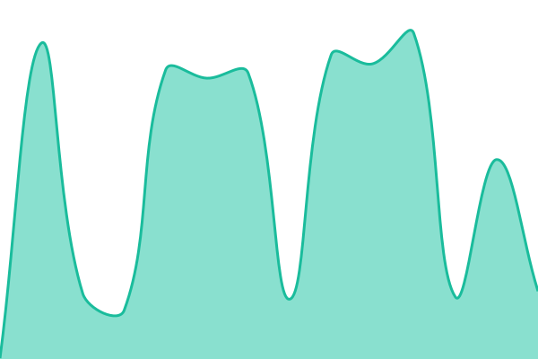
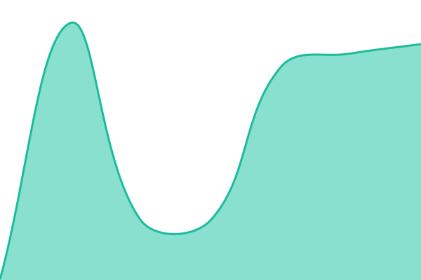
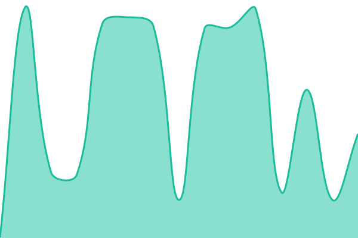
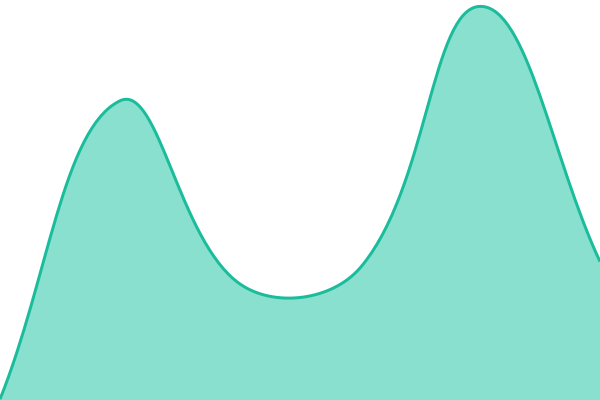
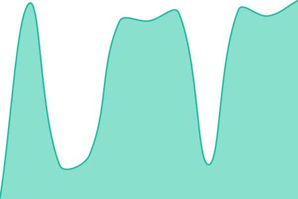

# [📈 Live Status](https://status.darkstardev.us): <!--live status--> **[ OK ] all systems operational**

This repository contains the open-source uptime monitor and status page for [jgruber96](https://status.darkstardev.us), powered by [Upptime](https://github.com/upptime/upptime).

With [Upptime](https://upptime.js.org), you can get your own unlimited and free uptime monitor and status page, powered entirely by a GitHub repository. We use [Issues](https://github.com/jgruber96/status/issues) as incident reports, [Actions](https://github.com/jgruber96/status/actions) as uptime monitors, and [Pages](https://status.darkstardev.us) for the status page.

<!--start: status pages-->
<!-- This summary is generated by Upptime (https://github.com/upptime/upptime) -->
<!-- Do not edit this manually, your changes will be overwritten -->
<!-- prettier-ignore -->
| URL | Status | History | Response Time | Uptime |
| --- | ------ | ------- | ------------- | ------ |
|  [darkstarinc.us](https://darkstarinc.us) | 🟩 Up | [darkstarinc.yml](https://github.com/jgruber96/status/commits/HEAD/history/darkstarinc.yml) | 

 190ms
     
 | 

<a href="https://status.darkstardev.us/history/darkstarinc">100.00%</a>
    

|  [darkstarDEV.us](https://darkstardev.us) | 🟩 Up | [darkstardev.yml](https://github.com/jgruber96/status/commits/HEAD/history/darkstardev.yml) | 

 258ms
     
 | 

<a href="https://status.darkstardev.us/history/darkstardev">39.95%</a>
    

|  [StarChores · Landing](https://darkstardev.us/starchores/) | 🟩 Up | [starchores-landing.yml](https://github.com/jgruber96/status/commits/HEAD/history/starchores-landing.yml) | 

 264ms
     
 | 

<a href="https://status.darkstardev.us/history/starchores-landing">100.00%</a>
    

|  [StarChores · Privacy](https://darkstardev.us/starchores/#privacy) | 🟩 Up | [starchores-privacy.yml](https://github.com/jgruber96/status/commits/HEAD/history/starchores-privacy.yml) | 

 264ms
     
 | 

<a href="https://status.darkstardev.us/history/starchores-privacy">100.00%</a>
    

|  [StarChores · Support](https://darkstardev.us/starchores/support/) | 🟩 Up | [starchores-support.yml](https://github.com/jgruber96/status/commits/HEAD/history/starchores-support.yml) | 

 255ms
     
 | 

<a href="https://status.darkstardev.us/history/starchores-support">100.00%</a>
    

|  [Analytics](https://stats.darkstardev.us/api/heartbeat) | 🟩 Up | [analytics.yml](https://github.com/jgruber96/status/commits/HEAD/history/analytics.yml) | 

 266ms
     
 | 

<a href="https://status.darkstardev.us/history/analytics">100.00%</a>
    

|  StarChores web app | 🟩 Up | [chore-web.yml](https://github.com/jgruber96/status/commits/HEAD/history/chore-web.yml) | 

 261ms
     
 | 

<a href="https://status.darkstardev.us/history/chore-web">100.00%</a>
    

<!--end: status pages-->

[**Visit our status website →**](https://status.darkstardev.us)

## 📄 License

- Powered by: [Upptime](https://github.com/upptime/upptime)
- Code: [MIT](./LICENSE) © [Anand Chowdhary](https://anandchowdhary.com), supported by [Pabio](https://pabio.com)
- Data in the `./history` directory: [Open Database License](https://opendatacommons.org/licenses/odbl/1-0/)
